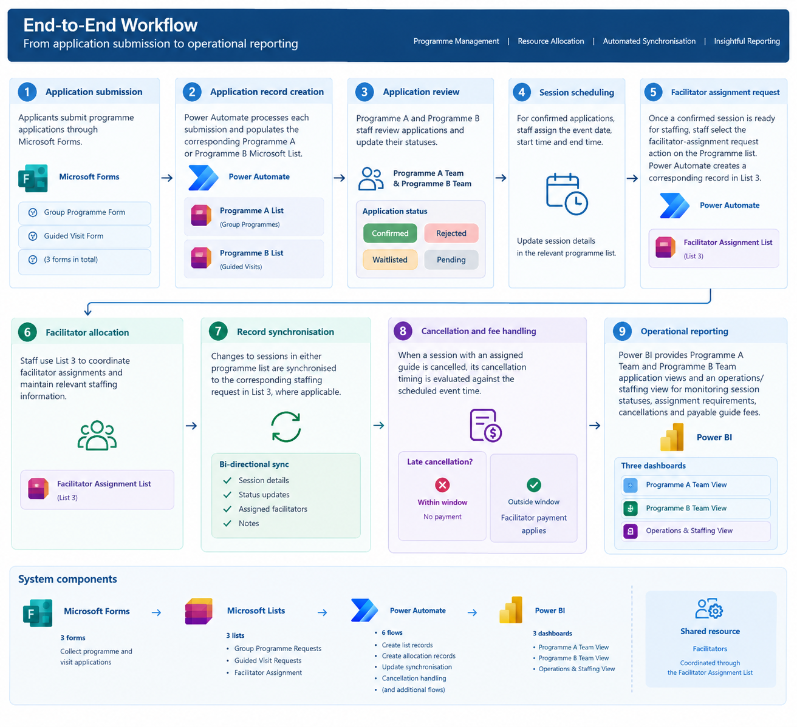
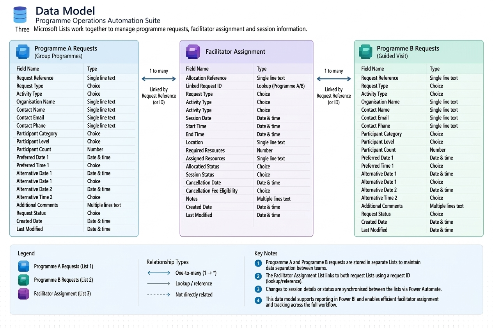
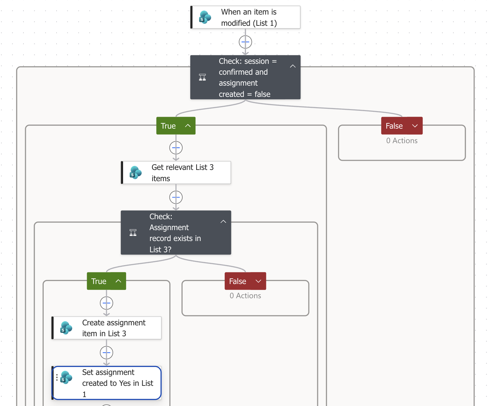
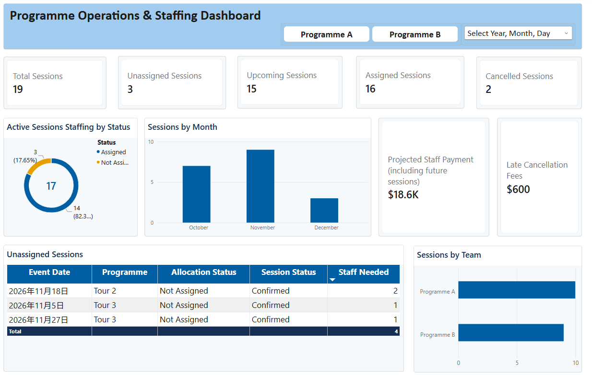
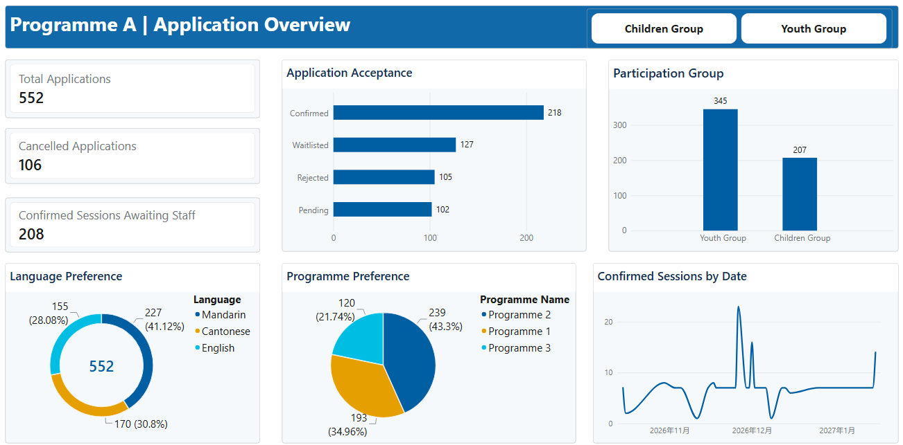
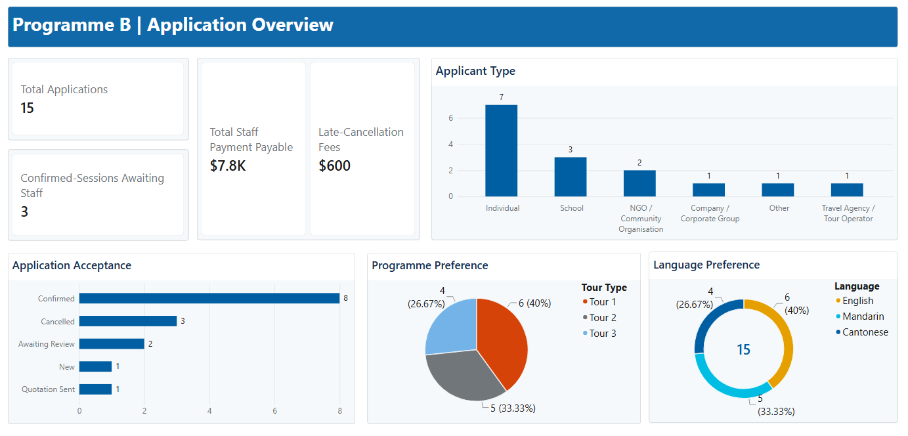

# Programme Operations Automation Suite

A self-directed Microsoft Power Platform project demonstrating how programme requests, resource allocation, operational updates, and reporting can be organised into a connected workflow.

The project uses Microsoft Forms, Microsoft Lists, Power Automate, and Power BI to explore how structured data and workflow automation can reduce repetitive administrative work and improve operational visibility.

> **Project scope:** This is an independent portfolio demonstration using a generalised operational scenario.

## 1. Project Overview

Programme-based organisations often need to coordinate incoming requests, confirm bookings, allocate staff or other resources, track changes, and monitor upcoming activities.

When these tasks are managed across separate records and manual updates, maintaining consistent information and producing timely reports can become difficult.

This project demonstrates a centralised approach to managing these activities using Microsoft Power Platform.

### Business Requirements
- **Data Isolation:** Programme A and Programme B teams must manage their own application records without visibility into each other’s operations.
- **Automated Resource Allocation:** Booking confirmations must automatically create linked resource-allocation requests without manual copy-pasting.
- **Bi-Directional Integrity:** Session timing, status updates, or cancellation details must remain perfectly aligned across both request and assignment repositories.
- **Unified Operational Reporting:** Leadership requires real-time visibility into overall booking volume, staffing gaps, and financial commitments in a single view.
  
### Objectives

- Structure programme requests in separate repositories for different operational teams.
- Automate the creation and synchronisation of records across Microsoft Lists.
- Maintain a shared resource-allocation repository.
- Track booking, allocation, and session statuses.
- Handle cancellation updates and related eligibility checks.
- Provide an interactive Power BI dashboard for operational monitoring.

## 2. Technology Stack

| Technology | Purpose |
|---|---|
| Microsoft Forms | Collect programme and visit requests |
| Microsoft Lists | Store request records and resource-allocation records |
| Power Automate | Automate record creation, status synchronisation, and update handling |
| Power BI Desktop | Visualise booking, allocation, and session information |

## 3. System Architecture

The demonstration utilizes a connected low-code ecosystem consisting of three Microsoft Lists: two separate request repositories and one central resource-allocation repository. This multi-list structure ensures that sensitive operational data for different program types (Group Programmes and Guided Visits) remains separated, supporting distinct operational workflows for different program teams.

The system automates the full program request lifecycle through nine key stages, from initial application submission to detailed operational reporting. When a request booking is confirmed in a program list, Power Automate automatically creates a linked record in the central Facilitator Assignment list (List 3) to initiate resource allocation. Crucially, the workflow incorporates bi-directional synchronization, ensuring that session updates, status changes, and assigned resources remain consistent across all three related records, while built-in automated checks enforce business rules for late-cancellation eligibility. The workflow culminates in interactive Power BI dashboards that consolidate and visualize live data from the Lists ecosystem for unified operational monitoring.

## 4. Data Model

### List 1 — Programme A Requests (Group Programme)

Stores requests for group activities, including relevant programme details, requested dates, group information, and booking status.

### List 2 — Programme B Requests (Guided Visit)

Stores guided-visit requests separately from group programme requests. This separation supports distinct operational processes and helps avoid unnecessary cross-team exposure of request records.

### List 3 — Facilitator Assignment

Acts as a shared repository for resource-allocation requests associated with confirmed sessions. It supports allocation tracking, status updates, and the synchronisation of relevant information with the original booking records.

## 5. Key Features and Automation

### 5.1 Request Management

- Collects requests through separate Microsoft Forms.
- Uses Power Automate to populate the corresponding request Lists in the demonstration.
- Handles optional form fields and alternative date information.
- Maintains separate request repositories for different activity types.

### 5.2 Automated Resource-Allocation Records

When a request meets the configured confirmation conditions, Power Automate creates a corresponding allocation record.

The workflow includes checks intended to prevent duplicate allocation records and initialises relevant allocation and session statuses.

#### Example Flow

### 5.3 Bidirectional Update Synchronisation

Power Automate synchronises relevant changes between booking records and their associated resource-allocation records.

This helps keep booking and allocation information aligned when assignments or session statuses change.

### 5.4 Cancellation and Eligibility Tracking

The workflows handle cancellation-related updates and evaluate configured eligibility conditions using session timing and cancellation information.

This demonstrates how business rules can be incorporated into an automated workflow rather than relying entirely on manual checks.

### 5.5 Operational Reporting with Power BI

The Power BI dashboard consolidates data from the request and allocation Lists to support operational monitoring.

The report includes:

- Total sessions and upcoming sessions
- Sessions requiring staffing attention
- Allocation status distribution
- Sessions by requesting team
- Monthly session trends
- A session-level table with dates, programme details, and allocation and session statuses
- Team filters and a date slicer

#### Operations & Staffing View

---

#### Programme A Team View

---

#### Programme B Team View

## 6. Business Value

The project demonstrates how a connected low-code workflow can support:

- **Reduced repetitive administration:** Automating record creation and routine updates.
- **More consistent information:** Synchronising relevant changes across related records.
- **Improved visibility:** Tracking booking and allocation statuses in one reporting interface.
- **Separation of operational data:** Keeping different request types in distinct repositories.
- **More structured exception handling:** Highlighting cancellations and sessions that require further attention.
- **Scalable reporting:** Using structured records as the basis for operational analysis.

## 7. Skills Demonstrated

- Microsoft Power Automate workflow design
- Microsoft Lists data organisation
- Conditional logic and data validation
- Cross-list record synchronisation
- Duplicate-prevention checks
- Business-rule implementation
- Power BI dashboard design
- Data modelling and operational reporting
- Process analysis and workflow documentation

## 9. Future Improvements

Potential extensions include:

- More robust error handling and flow-run monitoring.
- Additional data-quality checks and exception reporting.
- Improved role-based access and permission testing.

---

**Project type:** Independent portfolio demonstration  
**Platform:** Microsoft Power Platform  
**Focus:** Workflow automation, data synchronisation, resource allocation, and operational reporting

Note: The project is inspired by common programme-operations challenges. Its architecture and features should be understood as an independent demonstration.

## Author
**Karina Tan**
* Portfolio: [github.com/Karina9713](https://github.com/Karina9713)
* Email: tan9713@gmail.com
